<p align="right">
  <b>English</b> &nbsp;·&nbsp; <a href="./README.zh.md">简体中文</a>
</p>

<p align="center">
  <a href="https://github.com/lulabs-org">
    
  </a>
</p>

<h1 align="center">Shiming Yang · 杨仕明</h1>

<p align="center">
  <strong>Product-minded full-stack developer</strong><br />
  <em>Opportunities in the AI Era = Professional Competence × AI Mastery × Broad Capability</em><br />
  <a href="https://github.com/lulabs-org">Building at @lulabs-org</a> &nbsp;·&nbsp; 📍 Shenzhen, China &nbsp;·&nbsp; ✉️ <a href="mailto:shiming.y@qq.com">shiming.y@qq.com</a>
</p>

<p align="center">
  <a href="#featured-system--nove"></a>
  <a href="#product-constellation"></a>
  <a href="#toolbox"></a>
  <a href="https://github.com/shimingy-zx/sound-sentinel-obs"></a>
</p>

---

## Now

```yaml
building:
  core: "Nove — Organizational Context & Data Infrastructure for AI & Agents"
  interfaces: [Web, API, CLI, MCP, Skills]
  worlds_&_tools: "Agent Voxel World (3D Embodied Multiplayer World) & Creator Tools"
exploring: [Agent systems, Multi-agent worlds, Knowledge workflows, Formal methods]
north_star: "Make complexity useful, then make it disappear."
```

## Not Just Writing Code, But Building Complete Systems

Most of my public work is built at [Lu Lab](https://github.com/lulabs-org). I love starting from real, chaotic business environments, navigating across product design, front-end, back-end, data pipelines, Agent interfaces, CLI tools, and native system integrations. I keep the complexity engineered inside the system, delivering calm, effortless clarity to users.

> **A complex system shouldn't feel complex to use.** This is the engineering standard I hold myself to.

## Featured system · Nove

<table>
  <tr>
    <td width="68%" valign="top">
      <h3>🧠 <a href="https://github.com/lulabs-org/nove">Nove</a></h3>
      <p>Organizational data infrastructure for AI and Agents, structuring meetings, transcripts, participants, and business context into actionable knowledge workflows.</p>
      <p>I helped build the complete product stack spanning backend services, admin console, CLI tooling, permission models, data contracts, and project documentation.</p>
      <p>
        <a href="https://github.com/lulabs-org/nove"><code>MONOREPO</code></a> &nbsp;
        <a href="https://github.com/lulabs-org/nove/tree/main/apps/api"><code>API</code></a> &nbsp;
        <a href="https://github.com/lulabs-org/nove/tree/main/apps/admin"><code>ADMIN</code></a> &nbsp;
        <a href="https://github.com/lulabs-org/nove-cli"><code>CLI</code></a> &nbsp;
        <a href="https://github.com/lulabs-org/nove/tree/main/packages/skills"><code>SKILLS</code></a> &nbsp;
        <a href="https://github.com/lulabs-org/nove/tree/main/docs"><code>DOCS</code></a>
      </p>
    </td>
    <td width="32%" valign="top">
      <p><strong>System surface</strong></p>
      <p>
        • API & Data model<br />
        • Admin experience<br />
        • CLI & Agent access<br />
        • Permissions & contracts<br />
        • Docs & validation
      </p>
    </td>
  </tr>
</table>

## Product constellation

<table>
  <tr>
    <td width="50%" valign="top">
      <h3>🧱 <a href="https://github.com/lulabs-org/agent-voxel-world">Agent Voxel World</a></h3>
      <p>A standalone local multiplayer 3D voxel game prototype. Integrated with LLM autonomous decision agents, server-authoritative physics collision, 3D spatial audio, and real-time speech transcription subtitles.</p>
      <p>
        <code>TypeScript</code> <code>Three.js</code> <code>Colyseus</code> <code>AI Agent</code>
        &nbsp;·&nbsp; <a href="https://github.com/lulabs-org/agent-voxel-world/tree/main/docs"><strong>Docs ↗</strong></a>
      </p>
    </td>
    <td width="50%" valign="top">
      <h3>🔌 <a href="https://github.com/lulabs-org/Lulabs-MCP">LuLabs MCP</a></h3>
      <p>Encapsulates student and meeting summaries from Feishu Bitable into standard Model Context Protocol tools for AI assistant querying and synthesis.</p>
      <p>
        <code>MCP</code> <code>TypeScript</code> <code>Feishu</code> <code>Zod</code>
        &nbsp;·&nbsp; <a href="https://github.com/lulabs-org/Lulabs-MCP"><strong>GitHub ↗</strong></a>
      </p>
    </td>
  </tr>
  <tr>
    <td width="50%" valign="top">
      <h3>🎬 <a href="https://github.com/lulabs-org/covercast">Covercast</a></h3>
      <p>Visual background editor for vertical live streaming. Features an SVG canvas, template system, multi-scene management, and direct integration as an OBS browser source.</p>
      <p>
        <code>Next.js</code> <code>React</code> <code>SVG</code> <code>OBS</code>
        &nbsp;·&nbsp; <a href="https://covercast.lulabs.cn"><strong>Live Demo ↗</strong></a>
      </p>
    </td>
    <td width="50%" valign="top">
      <h3>🎙️ <a href="https://github.com/shimingy-zx/sound-sentinel-obs">SoundSentinel</a></h3>
      <p>Native OBS audio filter plugin: triggers recording when sound is detected and halts after sustained silence. Pure C++ with zero Python, WebSocket, or background daemon overhead.</p>
      <p>
        <code>C++</code> <code>CMake</code> <code>OBS Native</code> <code>Audio</code>
        &nbsp;·&nbsp; <a href="https://github.com/shimingy-zx/sound-sentinel-obs"><strong>GitHub ↗</strong></a>
      </p>
    </td>
  </tr>
  <tr>
    <td width="50%" valign="top">
      <h3>📄 <a href="https://github.com/lulabs-org/docuflow">DocuFlow</a></h3>
      <p>Automated DOCX / PDF generator driven by dynamic templates and strict schema validation, transforming repetitive paperwork into dependable engineering workflows.</p>
      <p>
        <code>Next.js</code> <code>DOCX</code> <code>PDF</code> <code>Automation</code>
        &nbsp;·&nbsp; <a href="https://next-word-auto.vercel.app"><strong>Live Demo ↗</strong></a>
      </p>
    </td>
    <td width="50%" valign="top">
      <h3>🌐 <a href="https://github.com/lulabs-org/lulab-website">Lu Lab Website</a></h3>
      <p>The web platform hosting lab content, projects, and community experiences, serving as the gateway for product design and technical experiments.</p>
      <p>
        <code>Next.js</code> <code>Three.js</code> <code>Auth</code> <code>Content</code>
        &nbsp;·&nbsp; <a href="https://www.lulabs.org"><strong>Live Site ↗</strong></a>
      </p>
    </td>
  </tr>
</table>

<details>
  <summary><strong>More projects & early prototypes</strong></summary>
  <br />

  - 🔐 [**BIP39 Dotmap Generator**](https://github.com/shimingy-zx/bip39_dotmap) — Client-side BIP39 mnemonic dotmap visualizer with dark mode and responsive layout · [Live Demo ↗](https://shimingy-zx.github.io/bip39_dotmap/)
  - 📝 [**Meeting Record Tool**](https://github.com/lulabs-org/meeting_record) — Audio transcript processing, speaker diarization, and automated meeting minutes extraction
  - 🐍 [**SoundSentinel (Python)**](https://github.com/shimingy-zx/sound-sentinel) — Early Python prototype for voice activity detection and automated OBS recording
</details>

## My engineering compass

<table>
  <tr>
    <td width="25%" valign="top">
      <strong>01 · Start from real use</strong><br />
      <sub>真实场景出发</sub>
      <p>Anchor every design in actual workflow pains, never in a checklist of technologies.</p>
    </td>
    <td width="25%" valign="top">
      <strong>02 · Design the boundary</strong><br />
      <sub>清晰定义边界</sub>
      <p>Rigorously design API contracts, data models, permissions, and cross-platform consistency.</p>
    </td>
    <td width="25%" valign="top">
      <strong>03 · Build end to end</strong><br />
      <sub>端到端打通闭环</sub>
      <p>Traverse frontends, backends, Agent protocols, and native tools to deliver cohesive systems.</p>
    </td>
    <td width="25%" valign="top">
      <strong>04 · Verify with evidence</strong><br />
      <sub>证据驱动验证</sub>
      <p>Guarantee reliability with reproducible tests, end-to-end evidence, and thorough docs.</p>
    </td>
  </tr>
</table>

## Toolbox

<table>
  <tr>
    <td width="22%"><strong>AI & Agents</strong></td>
    <td>DeepSeek · OpenAI · MCP (Model Context Protocol) · Agent Workflows · Knowledge Systems</td>
  </tr>
  <tr>
    <td><strong>Application</strong></td>
    <td>TypeScript · React · Next.js · Three.js · Colyseus · NestJS · Node.js · Python</td>
  </tr>
  <tr>
    <td><strong>Data & Infra</strong></td>
    <td>PostgreSQL · Prisma · Redis · BullMQ · RESTful APIs · GraphQL</td>
  </tr>
  <tr>
    <td><strong>Native & Tools</strong></td>
    <td>C++ · CMake · OBS Native · Go · Browser Extensions · Shell</td>
  </tr>
</table>

---

<p align="center">
  <strong>Currently exploring</strong><br />
  AI product infrastructure · Agent systems · Knowledge workflows · Developer tooling · Programming languages & formal methods
</p>

<p align="center">
  <sub>Open to thoughtful conversations about ambitious ideas and dependable software.</sub>
</p>

<p align="center">
  <a href="mailto:shiming.y@qq.com">
    
  </a>
  &nbsp;
  <a href="https://github.com/shimingy-zx">
    
  </a>
</p>
